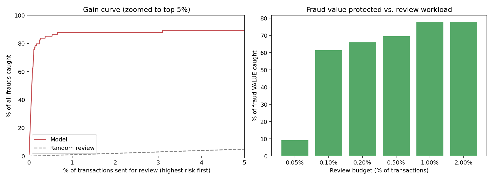
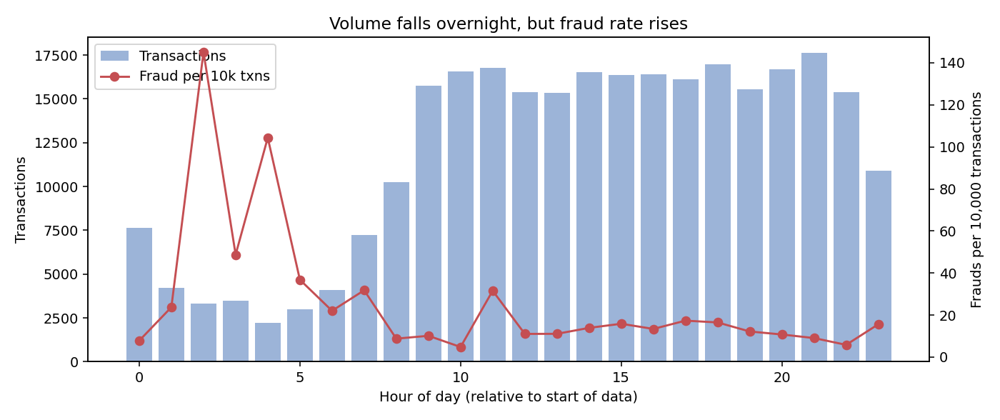

# Credit Card Fraud Analysis

End-to-end statistical and machine-learning analysis of 283,726 card transactions
(473 frauds, 0.17%): data validation, hypothesis testing, modelling, and business
impact analysis.

## Key findings
- **Micro-transactions:** 36% of frauds are 1 currency unit or less, versus 11% of
  legitimate transactions (odds ratio 4.75), consistent with card testing.
- **Night hours:** fraud is about 3-4x more frequent in the first six hours of the
  daily cycle, and the pattern holds on both days.
- **Review capacity:** reviewing only the top 0.1% of transactions catches 69% of
  frauds at 89% precision. Returns diminish sharply beyond 1%.
- **Count vs value:** the model catches 73% of frauds by count but only 63% by value,
  so value-weighted detection should be reported alongside count-based detection.
- **Model result:** Gradient Boosting reached a test PR-AUC of 0.785 (95% CI 0.69-0.87)
  versus 0.001 for the baseline. Operating point: 85.7% precision, 73.0% recall.
  The three models tested are statistically indistinguishable (overlapping intervals).

## Method
1. Data validation and duplicate removal (1,081 duplicates)
2. Statistical EDA: Mann-Whitney, Fisher's exact, chi-square
3. Chronological train / validation / test split (no leakage)
4. Logistic regression, random forest, gradient boosting with class weights
5. Cost-based alert threshold chosen on validation data only
6. Bootstrap confidence intervals, alert-budget analysis, PSI drift monitoring

Full explanation, limitations and interview Q&A: see [REPORT.md](REPORT.md).

## Run it
1. Download `creditcard.csv` from Kaggle ("Credit Card Fraud Detection", ULB Machine
   Learning Group with Worldline) and place it at `data/creditcard.csv`.
   The dataset is not included in this repository.
2. `pip install -r requirements.txt`
3. `python fraud_pipeline.py --data data/creditcard.csv --out outputs`
   (about 3-4 minutes on a single CPU core, seed = 42)

## Outputs
- `outputs/results.json`: every number quoted in the report
- `outputs/figures/`: 8 charts
- `outputs/tables/`: model comparison, alert-budget table, feature importance, drift
- `outputs/model/fraud_model.joblib`: trained model, threshold and feature list

## Limitations
2013 European data with anonymised PCA features, only two days, 74 test-period frauds,
and an assumed review cost of 5 units. See REPORT.md for details.